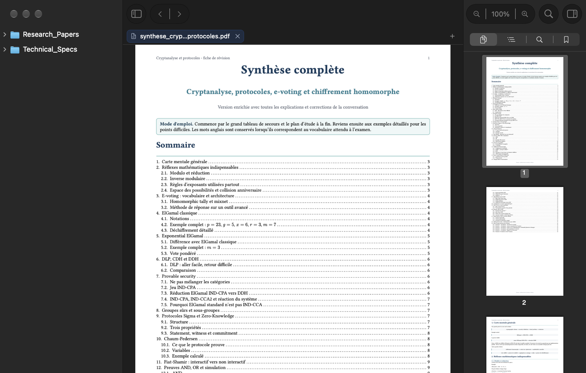

# Iridescence PDF Reader

<p align="center">
  
</p>

<p align="center">
  <b>A fast, lightweight, native macOS PDF reader engineered in pure Rust with AppKit and PDFKit.</b><br>
  Zero Electron. Zero WebKit bloat. Native Liquid Glass materials. Apple Vision OCR on demand.
</p>

<p align="center">
  <a href="https://github.com/gobelet69/iridecence-pdf-reader/releases/latest"></a>
  
  
  
  
  
</p>

---

## 1. Overview

**Iridescence PDF Reader** is a high-performance document reader engineered specifically for macOS power users, researchers, and engineers. By pairing Rust's memory safety with direct Objective-C bindings (`objc2`) to Apple's native **AppKit**, **PDFKit**, and **Vision** frameworks, Iridescence achieves instant cold startup (<250 ms), a minimal memory footprint (<60 MB base idle RAM), and deep macOS interface ergonomics.

---

## 2. Genuine Application Screenshots

| Workspace Reader (Light) | Workspace Reader (Dark) |
|:---:|:---:|
|  |  |

| Home Screen (Light) | Home Screen (Dark) |
|:---:|:---:|
|  |  |

| Native Multi-Document Tabs | Real-Time Annotations & Inspector |
|:---:|:---:|
|  |  |

| Command Palette & Quick Open | On-Device Apple Vision OCR |
|:---:|:---:|
|  |  |

---

## 3. Main Features

- **Native Liquid Glass Design**: Fully translucent window structure using `NSVisualEffectView` (`BehindWindow` / `UnderWindowBackground`) with soft accent-tinted selection capsules (`GlassTableRowView`) and a single-row hover coordinator. Adapts automatically to Light and Dark macOS system appearances.
- **Multi-Document Tabs**: Isolated document sessions per tab with independent reading positions, zoom factors, undo stacks, and dirty annotation tracking. Full AZERTY/QWERTY layout-independent tab switching.
- **Native Annotations & Atomic Saving**: Highlight (`Cmd+Shift+H`), underline (`Cmd+Shift+U`), strikeout (`Cmd+Shift+X`), and text notes (`Cmd+Shift+N`) powered by PDFKit. Crash-resilient atomic file persistence (`Cmd+S`) with write-protection guards for sensitive or read-only folders.
- **On-Device Apple Vision OCR**: Local optical character recognition using Apple's Vision framework (`VNRecognizeTextRequest`). Scanned and non-searchable documents become selectable, searchable, and exportable without external network requests.
- **Spotlight-Style Command Palette**: Floating quick-open launcher (`Cmd+P`) and action palette (`Cmd+Shift+P`) providing keyboard-driven navigation across commands, files, page numbers, and index queries.
- **Background Workspace Indexer**: Background crawler indexing PDFs across chosen directories into a memory-mapped cache with DOS-mitigation bounds and cycle protection.

---

## 4. System Requirements

- **Operating System**: macOS 14.0 (Sonoma) or later (fully verified on macOS 14 through macOS 15+).
- **Architecture**: Apple Silicon (`arm64`, M1/M2/M3/M4) native. Intel (`x86_64`) supported via source compilation.
- **RAM**: 50 MB baseline memory footprint.
- **Storage**: ~10 MB for application installation.

---

## 5. Installation Instructions

1. Download the latest release `.dmg` from the **[GitHub Releases](https://github.com/gobelet69/iridecence-pdf-reader/releases/latest)** page:
   - `Iridecence-PDF-Reader-v0.5.1-macOS-arm64.dmg`
2. Open the downloaded `.dmg` file.
3. Drag **Iridecence PDF Reader.app** into your `/Applications` directory.
4. Launch the application from Launchpad, Spotlight, or the Applications folder.
5. *Note on initial launch*: If Gatekeeper prompts about Developer ID verification on an ad-hoc or unsigned community build, right-click the application icon and select **Open**, then confirm.

---

## 6. Getting Started

1. **Launch Iridescence PDF Reader**: On startup, you are greeted by the clean Home screen showing recent documents and quick actions.
2. **Open a Single Document**: Press `Cmd + O` or drag a PDF onto the window to begin reading immediately.
3. **Open a Workspace Folder**: Press `Cmd + Shift + O` to select a project or research folder. The left sidebar displays the complete directory tree while indexing documents in the background.
4. **Navigate**: Use the thumbnail strip on the left for page jumps, or press `Cmd + P` to search across all documents in your workspace.

---

## 7. Usage Instructions

### Reading and Navigation
- **Zooming**: Use trackpad pinch-to-zoom, `Cmd + +`, `Cmd + -`, or press `Cmd + 0` to return to actual size (100%).
- **Display Modes**: Toggle between Single Page and Continuous Scroll from the View menu or command palette.
- **Focus Mode**: Press `Cmd + Shift + F` to collapse sidebars and immerse yourself entirely in the text.
- **Presentation Mode**: Press `Cmd + Return` for full-screen reading.

### Annotating Documents
- Select any text passage with your mouse or trackpad.
- A floating context menu offers immediate actions: Highlight, Underline, Strikeout, Copy with Page Reference, or Copy as Markdown Quote.
- Notes and comments appear in the right-hand inspector panel, where they can be searched, filtered, and exported.

### Extracting Text via OCR
- When viewing a scanned document or image page, press `Cmd + Shift + R` or select **Perform OCR** from the toolbar.
- Apple's Vision framework analyzes the page locally on your Neural Engine / GPU and displays the recognized text in an inspector sidebar.

---

## 8. Keyboard Shortcuts

Iridescence PDF Reader maps keyboard shortcuts using physical hardware keycodes, ensuring reliable operation on AZERTY, QWERTZ, Dvorak, and standard QWERTY keyboards alike.

| Shortcut | Action |
|:---|:---|
| `Cmd + O` | Open PDF File |
| `Cmd + Shift + O` | Open Workspace Directory |
| `Cmd + Option + H` | Return to Home Screen |
| `Cmd + S` | Safe Atomic Save (Document & Annotations) |
| `Cmd + Shift + S` | Save As… |
| `Cmd + T` | Open New Document Tab |
| `Cmd + W` | Close Active Tab / Return to Home |
| `Cmd + Shift + ]` / `Cmd + Shift + [` | Next / Previous Document Tab |
| `Cmd + 1` … `Cmd + 8` | Switch to Tab 1 through 8 |
| `Cmd + 9` | Switch to Final Tab |
| `Cmd + P` | Quick Open / Universal Workspace Search |
| `Cmd + Shift + P` | Command Palette (Prefix `>`) |
| `Cmd + F` | Search in Active Document |
| `Cmd + G` / `Cmd + Shift + G` | Find Next / Find Previous |
| `Cmd + E` | Use Selection for Find |
| `Cmd + L` | Jump to Page Number |
| `Cmd + [` / `Cmd + ]` | Reading History: Navigate Back / Forward |
| `Cmd + D` | Toggle Bookmark for Current Page |
| `Cmd + I` | View Document Metadata & Information |
| `Cmd + Shift + H` | Highlight Selected Text |
| `Cmd + Shift + U` | Underline Selected Text |
| `Cmd + Shift + X` | Strikeout Selected Text |
| `Cmd + Shift + N` | Add Note to Selection |
| `Cmd + Shift + M` | Copy Selection formatted as Markdown Quote |
| `Cmd + Shift + R` | Perform On-Device OCR (Apple Vision) |
| `Cmd + 0` | Actual Size (100% Zoom) |
| `Cmd + Shift + F` | Toggle Focus Reading Mode |
| `Cmd + Return` | Toggle Presentation Mode |
| `Cmd + ,` | Settings and Preferences |

---

## 9. Building from Source

### Prerequisites
- macOS 14.0 or newer.
- [Rust](https://rustup.rs/) (stable channel, 1.85+ recommended for the 2024 edition).
- Xcode Command Line Tools:
  ```bash
  xcode-select --install
  ```

### Build Steps

1. Clone the repository:
   ```bash
   git clone https://github.com/gobelet69/iridecence-pdf-reader.git
   cd iridecence-pdf-reader
   ```
2. Build and run in debug mode:
   ```bash
   cargo run
   ```
3. Build the self-contained macOS `.app` bundle:
   ```bash
   ./build_app.sh
   open "Iridecence PDF Reader.app"
   ```
4. Package a distributable `.dmg`:
   ```bash
   ./scripts/build_dmg.sh 0.5.1
   ```

> [!TIP]
> If your source checkout is located in an iCloud Drive-synced folder (`~/Documents`), compile with `CARGO_TARGET_DIR=/tmp/target` to prevent macOS FileProvider coordination locks from stalling the compilation.

### Running Automated Tests

```bash
CARGO_INCREMENTAL=0 CARGO_TARGET_DIR=/tmp/target cargo test
```
All 43 unit and integration tests execute in under 1 second.

---

## 10. Troubleshooting

- **The app shows an untrusted developer warning on first launch**:
  Because ad-hoc builds are not signed with a paid Apple Developer ID certificate, right-click `Iridecence PDF Reader.app` in Finder, choose **Open**, and click **Open** in the dialog. Alternatively, remove the quarantine attribute:
  ```bash
  xattr -dr com.apple.quarantine "/Applications/Iridecence PDF Reader.app"
  ```
- **Workspace indexing is slow on network drives**:
  Workspace indexing is optimized for local APFS volumes. For large network mounts or external drives, open individual files or subfolders directly rather than indexing top-level directories.
- **OCR results are empty**:
  Apple Vision OCR requires macOS 14+ and clear text resolution. Ensure the document page is right-side up and contains recognizable characters.

---

## 11. Known Limitations

- **PDF Forms (AcroForms)**: Interactive form filling is currently read-only.
- **Embedded Audio/Video**: Multimedia annotations embedded within PDFs are not played back.
- **Platform Scope**: Designed strictly for macOS. There is no intention to port to Windows or Linux, as the core UI relies natively on AppKit and PDFKit.

---

## 12. Download and Releases

All verified releases and checksums are published on GitHub:
- **Latest Release**: [GitHub Releases](https://github.com/gobelet69/iridecence-pdf-reader/releases)
- **Official Showcase**: [111iridescence.org/apps/iridescence-pdf-reader](https://111iridescence.org/apps/iridescence-pdf-reader)

Every release includes an official `.dmg` installer and corresponding `SHA256SUMS.txt` cryptographic verification file.

---

## 13. Contributing

Contributions and issue reports are welcomed. Please review [CONTRIBUTING.md](CONTRIBUTING.md) and [SECURITY.md](SECURITY.md) before submitting pull requests. All changes must pass `cargo test` and maintain AppKit HIG standards.

---

## 14. Licence

This project is licensed under the **[MIT Licence](LICENSE)**.

---

## 15. Acknowledgements

- Built with native Apple technologies: AppKit, PDFKit, and Apple Vision.
- Direct Objective-C runtime integration made possible by the [`objc2`](https://github.com/madsmtm/objc2) framework.
- Developed by **[111iridescence](https://111iridescence.org)** with AI-assisted software systems engineering.
