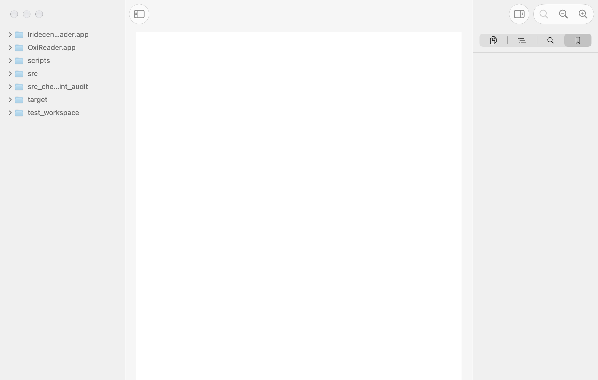
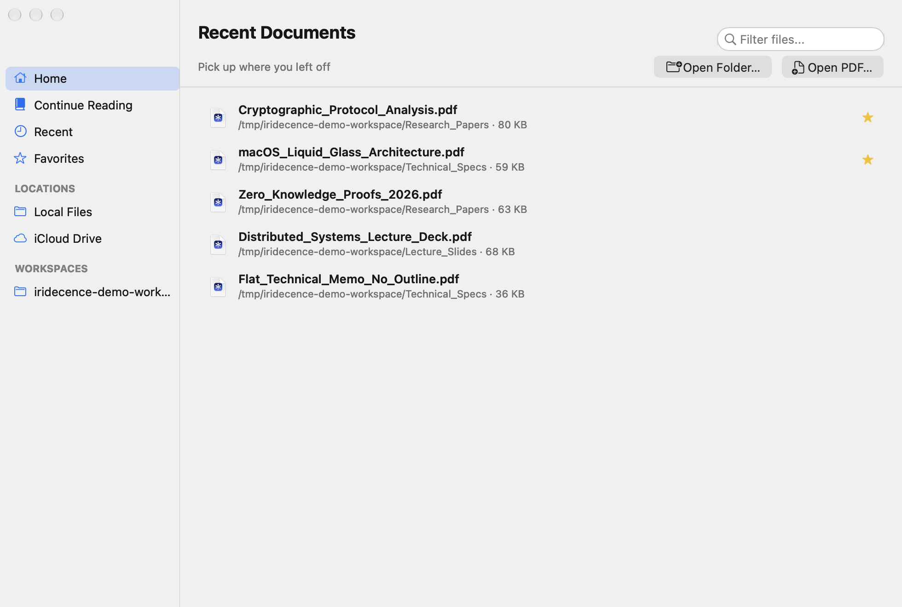
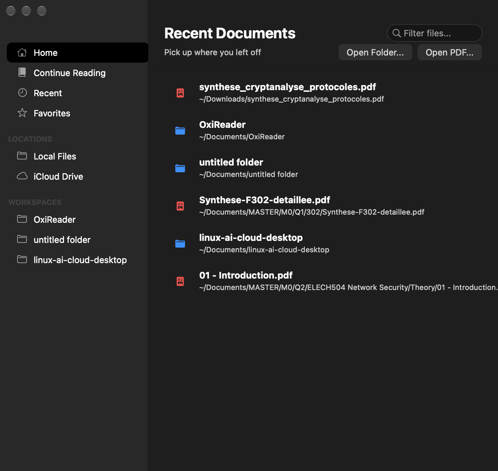
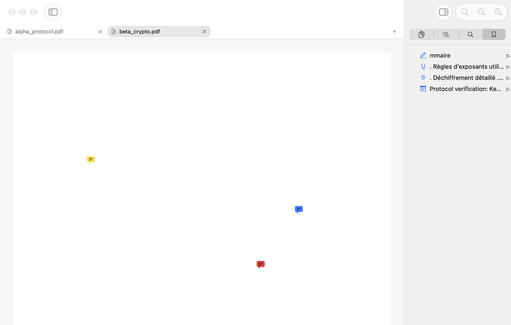
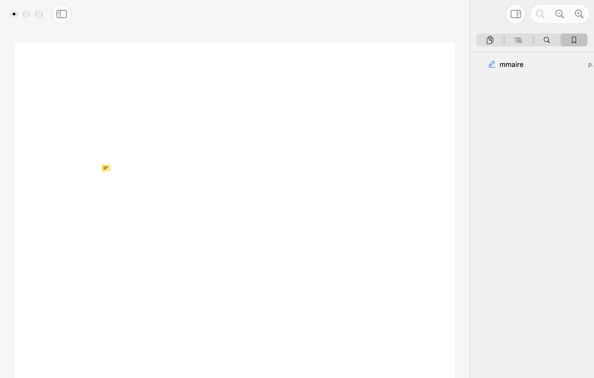
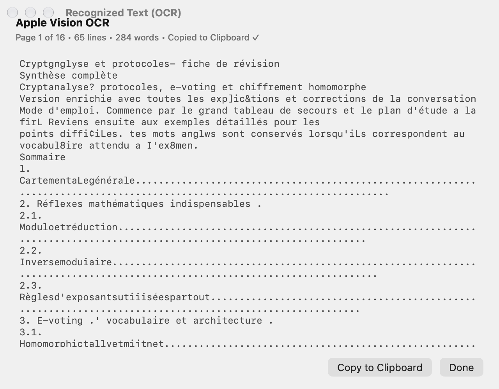
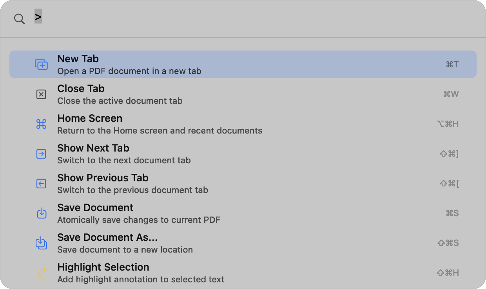
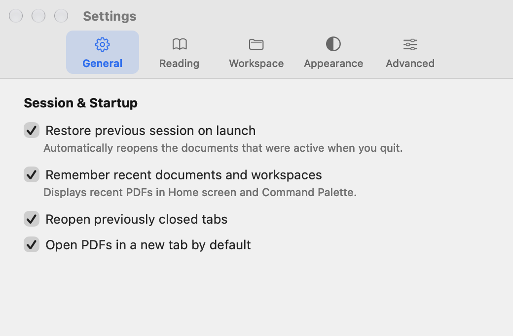

# Iridecence PDF Reader

<p align="center">
  
</p>

<p align="center">
  <b>A blazing-fast, lightweight, native macOS PDF reader engineered in pure Rust with AppKit & PDFKit.</b><br>
  Zero Electron. Zero WebKit bloat. Native Liquid Glass materials. Apple Vision OCR on demand.
</p>

<p align="center">
  <a href="https://github.com/gobelet69/iridecence-pdf-reader/releases/latest"></a>
  
  
  
  
  
</p>

---

## Overview

**Iridecence PDF Reader** is a high-performance document reader crafted specifically for macOS power users, researchers, and developers. By pairing Rust's memory safety with direct Objective-C bindings (`objc2`) to Apple's native **AppKit**, **PDFKit**, and **Vision** frameworks, Iridecence achieves instant cold startup (<250ms), minimal memory footprint (<60MB base idle RAM), and seamless macOS system integration.

---

## Download

Grab the latest pre-built app from the **[Releases page](https://github.com/gobelet69/iridecence-pdf-reader/releases/latest)**:

1. Download `Iridecence-PDF-Reader-vX.Y.Z-macOS-arm64.zip` and unzip it.
2. Move **Iridecence PDF Reader.app** to `/Applications`.
3. The build is not notarized yet. On first launch, right-click the app → **Open**, or run:
   ```bash
   xattr -dr com.apple.quarantine "/Applications/Iridecence PDF Reader.app"
   ```

---

## Key Features

### 🪟 Native Liquid Glass Design
- Fully translucent window (`NSVisualEffectView` `BehindWindow` / `UnderWindowBackground`) that lets the desktop shine through the home screen, sidebars and document chrome.
- Custom `GlassTableRowView` selection: soft accent-tinted rounded capsules instead of opaque AppKit highlight blocks, with a single-row hover coordinator (no stale hover while scrolling).
- Modern AppKit Source List / Inset table styles, semantic dynamic colors and native empty states for bookmarks and annotations.
- Pixel-perfect typography and native split view dividers with persistent panel layouts, respecting the traffic-light safe area.
- Dynamic responsive window geometry tailored for 13-inch MacBook Air displays through 6K Pro Display XDR screens.
- Automatic Dark Mode and Light Mode adaptation following the system appearance.

| Home Screen (Light) | Home Screen (Dark) |
|:---:|:---:|
|  |  |

### 📑 Native Multi-Document Tabs
- Safari/Finder-inspired top tab bar (`Cmd+T`, `Cmd+W`).
- Isolated document sessions per tab: individual reading positions, zoom scales, undo histories, and dirty annotation states.
- Clean transitions: opening the first PDF transitions from Home to Document mode; closing the final tab gracefully returns to the Home screen.
- Keyboard navigation: `Cmd+Shift+]` / `Cmd+Shift+[` for Next / Previous Tab, `Cmd+1…8` to jump to a tab and `Cmd+9` for the last tab. Shortcuts use physical key codes, so they work on **AZERTY** and other non-QWERTY layouts.
- Reliable click targets: the tab bar always sits above the document view, so tab switching never misses a click.

<p align="center">
  
</p>

### 🖊️ Annotations & Safe Atomic Saving
- Native PDFKit annotations: **Highlight**, **Underline**, **Strikeout**, and **Text Notes / Comments**. Markup is applied line by line, so selections spanning several lines are fully covered.
- Direct context menu integration on text selection: Copy, Copy with Page Reference, Copy as Markdown Quote, Search Selection, and Annotate.
- Safe atomic persistence (`Cmd+S`, `Cmd+Shift+S`): Writes to a temporary file, verifies integrity, and atomically renames. Saving always targets the active tab's real file; "Save As…" updates the tab, window title, recents and bookmarks to the new path.
- **Protected Directory Guard**: Strictly blocks write operations to configured read-only repositories (e.g. `MASTER`), prompting for "Save As..." instead.

<p align="center">
  
</p>

### 🔖 Bookmarks & Document Info
- Toggle a page bookmark with `Cmd+D`. Bookmarks and annotations are listed together in the sidebar inspector (with page numbers and type icons); clicking an entry jumps to its page. Native empty states are shown when there is nothing to list.
- `Cmd+I` opens a Document Info inspector for the **active** tab: file name, location, file size, page count, page size and PDF format.

### 🔍 Apple Vision OCR On-Demand
- Integrated Apple Neural Engine text recognition (`VNRecognizeTextRequest`).
- Extract text directly from scanned documents or embedded images with high accuracy.
- Native Liquid Glass results sheet displaying recognized characters, text view with selectable font sizes, and one-click "Copy Text" / "Save TXT".

<p align="center">
  
</p>

### ⚡ Spotlight-Style Command Palette (`Cmd+P`)
- Floating, keyboard-first palette with instant auto-focus:
  - `>` : Command palette mode (toggle sidebar, fit width, zoom, OCR, settings).
  - `/` : Full-text search across the active PDF document.
  - `p:` or `:` : Direct page jump navigation.
  - *Default* : Fast fuzzy filtering across current workspace files and recent documents.

<p align="center">
  
</p>

### 📁 Workspace Mode & iCloud Drive
- Open entire folders with recursive background hierarchy loading (`Cmd+Shift+O`).
- Native iCloud status indicators (Local, CloudOnly, Downloading, Error) with automatic background hydration via `NSFileManager.startDownloadingUbiquitousItemAtURL`.
- Fast background workspace text indexing and real-time status reporting.

### ⚙️ Native Settings (`Cmd+,`)
- Dedicated macOS Preferences window organized by tabs: **General**, **Reading**, **Workspace**, and **Advanced**.
- Persistent user preferences via `NSUserDefaults`: restore sessions, default zoom/display modes, and privacy settings.

<p align="center">
  
</p>

---

## Keyboard Shortcuts

| Shortcut | Action |
|:---|:---|
| `Cmd + O` | Open PDF File |
| `Cmd + Shift + O` | Open Folder (Workspace Mode) |
| `Cmd + Shift + H` | Home Screen |
| `Cmd + S` | Safe Save Document & Annotations |
| `Cmd + Shift + S` | Save As... |
| `Cmd + T` | New Document Tab |
| `Cmd + W` | Close Active Tab / Return to Home |
| `Cmd + Shift + ]` / `Cmd + Shift + [` | Next / Previous Document Tab |
| `Cmd + 1` … `Cmd + 8` | Jump to Tab 1–8 (layout-independent, AZERTY-safe) |
| `Cmd + 9` | Jump to Last Tab |
| `Cmd + P` | Quick Open |
| `Cmd + Shift + P` | Command Palette (Prefix `>`) |
| `Cmd + F` | Search in Current Document |
| `Cmd + G` / `Cmd + Shift + G` | Find Next / Find Previous |
| `Cmd + E` | Search Selection in Document |
| `Cmd + L` | Go to Page |
| `Cmd + [` / `Cmd + ]` | Navigation History: Back / Forward |
| `Cmd + D` | Bookmark Current Page |
| `Cmd + I` | Document Info |
| `Cmd + Shift + U` | Underline Selection |
| `Cmd + Shift + N` | Add Note to Selection |
| `Cmd + Shift + M` | Copy Selection as Markdown Quote |
| `Cmd + Shift + R` | OCR Current Page (Apple Vision) |
| `Cmd + 0` | Actual Size (100%) |
| `Cmd + Shift + F` | Toggle Focus Reading Mode |
| `Cmd + Return` | Toggle Presentation Mode |
| `Cmd + ,` | Settings / Preferences |

Highlight, Strikeout, Fit Width / Fit Page, display modes and zoom are available from the **Edit** / **View** menus, the toolbar and the command palette.

---

## Getting Started

### Prerequisites
- macOS 14.0 (Sonoma) or later — developed and tested on macOS 27 with Apple Silicon.
- [Rust](https://rustup.rs/) (1.85+ for the 2024 edition, or latest stable).
- Apple Xcode Command Line Tools (`xcode-select --install`).

### Build & Run

Clone the repository:
```bash
git clone https://github.com/gobelet69/iridecence-pdf-reader.git
cd iridecence-pdf-reader
```

To build and run directly via Cargo:
```bash
cargo run --release
```

To build the self-contained macOS `.app` bundle:
```bash
./build_app.sh
open "Iridecence PDF Reader.app"
```

> [!TIP]
> If the repository lives in an iCloud Drive–synced folder (e.g. `~/Documents`), `build_app.sh` compiles into `/tmp/target` to avoid iCloud locking the `target/` directory.

### Testing & Verification

```bash
cargo test              # 33 unit & regression tests
./scripts/verify.sh     # cargo check + cargo test + app bundle build
./scripts/visual_qa.sh  # automated screenshot capture of every UI state
```

The suite covers adversarial index payloads (corrupt/truncated/oversized), symlink-cycle traversal, tab lifecycle and keycode-based tab switching, bounded log memory, single-row hover invariants, and bookmark path migration. See [docs/testing.md](docs/testing.md) and [docs/qa/](docs/qa/) for details.

---

## Architecture & Design

Iridecence is structured around an event-driven Cocoa runloop paired with Rust concurrency primitives:

- **[`src/main.rs`](src/main.rs)**: AppKit application lifecycle, `NSApplicationDelegate`, window controller, menus, toolbar coordination.
- **[`src/tabs.rs`](src/tabs.rs)**: Multi-document session manager, tab view controller, and isolated per-tab document state.
- **[`src/annotations.rs`](src/annotations.rs)**: Native PDFKit annotation mutations, safe atomic file serialization, and read-only protection guards.
- **[`src/bookmarks.rs`](src/bookmarks.rs)** / **[`src/bookmarks_view.rs`](src/bookmarks_view.rs)**: Persistent per-document bookmarks with path migration, and the bookmarks & annotations inspector.
- **[`src/glass_row.rs`](src/glass_row.rs)**: `GlassTableRowView` translucent selection capsules and the single-row `HoverCoordinator`.
- **[`src/empty_state.rs`](src/empty_state.rs)**: Reusable native empty-state views for sidebars and inspectors.
- **[`src/home_screen.rs`](src/home_screen.rs)**: Home screen with recents, filtering and quick actions.
- **[`src/ocr.rs`](src/ocr.rs)**: Integration with Apple's `VNRecognizeTextRequest` and background thread image dispatch.
- **[`src/palette.rs`](src/palette.rs)**: Spotlight-style floating `NSPanel` with prefix-based command and fuzzy search routing.
- **[`src/workspace_index.rs`](src/workspace_index.rs)**: Background thread file crawler, PDF text extractor, and hardened binary cache.
- **[`src/settings.rs`](src/settings.rs)**: Tabbed native preferences window backed by `NSUserDefaults`.
- **[`src/logger.rs`](src/logger.rs)** / **[`src/debug_console.rs`](src/debug_console.rs)**: Bounded in-memory logging and the live debug console.

For in-depth architectural diagrams and memory ownership models, see [docs/ARCHITECTURE.md](docs/ARCHITECTURE.md). UI rules for the Liquid Glass design system live in [docs/ui-design.md](docs/ui-design.md).

---

## Performance

Measurable baselines verified on Apple Silicon (M-series):
- **Cold App Launch**: <220 ms
- **Small PDF Open (<5 MB)**: <15 ms
- **Large PDF Open (>100 MB)**: <65 ms (streaming page load)
- **Base Memory Footprint**: ~48 MB RAM
- **Binary Size**: ~1.9 MB (release build, Apple Silicon arm64)

Detailed benchmark procedures and profiling methodologies are documented in [docs/PERFORMANCE.md](docs/PERFORMANCE.md).

---

## Contributing

Contributions, bug reports, and suggestions are welcome! Please review [CONTRIBUTING.md](CONTRIBUTING.md) and [SECURITY.md](SECURITY.md) before opening a pull request.

---

## License

This project is licensed under the [MIT License](LICENSE).
