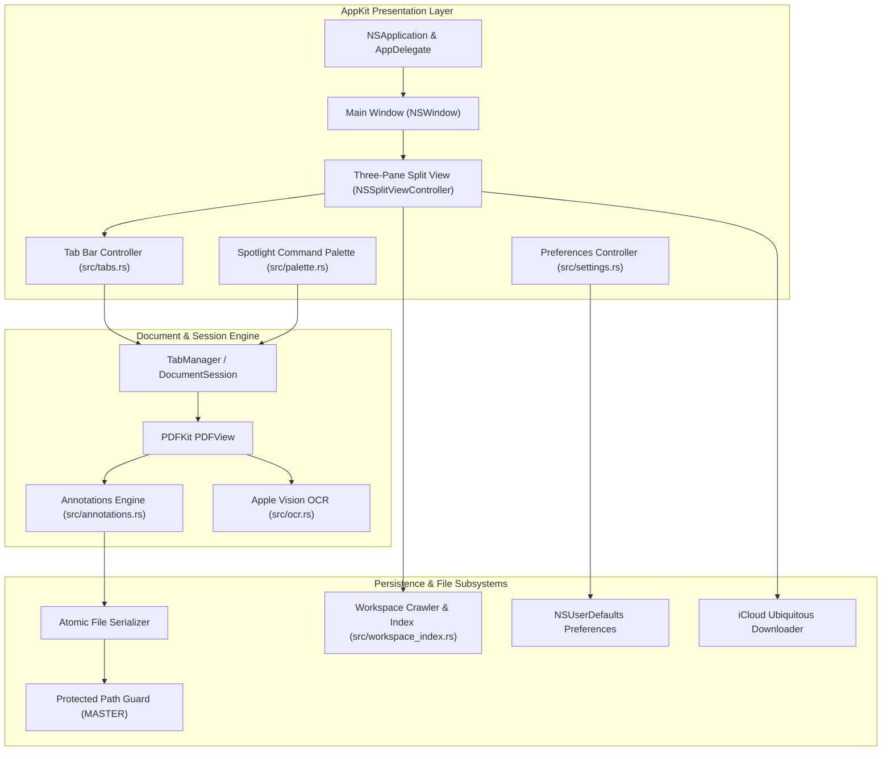

# Iridecence PDF Reader — Architecture & Design

This document details the architectural principles, subsystem design, and data flows of **Iridecence PDF Reader**.

---

## 1. System Overview

Iridecence is engineered in Rust using direct Objective-C run-time bindings (`objc2`) to Apple's native frameworks: **AppKit**, **PDFKit**, and **Vision**.

---

## 2. Objective-C Bridge & Concurrency Model

### 2.1 The `objc2` Memory and Threading Model
All interactions with AppKit are routed through the `objc2` (v0.6+) family of crates:
- `MainThreadMarker`: Enforces compile-time thread-safety guarantees that AppKit controls and window manipulations run exclusively on the main Cocoa UI thread.
- `Retained<T>`: Represents unique or shared reference-counted ownership of Objective-C objects, adhering strictly to Cocoa ARC semantics.
- `define_class!`: Declares native Objective-C classes in pure Rust, implementing delegates such as `NSApplicationDelegate`, `NSWindowDelegate`, `NSOutlineViewDataSource`, `NSToolbarDelegate`, and `NSSearchFieldDelegate`.

### 2.2 Concurrency & Background Offloading
- The main thread is never blocked by I/O, OCR, or file indexing.
- Heavy operations are dispatched onto worker threads via `std::thread::spawn`.
- Background threads communicate completion back to the main thread via Cocoa's runloop or `msg_send![target, performSelectorOnMainThread: ... waitUntilDone: false]`.

---

## 3. Subsystem Breakdown

### 3.1 Multi-Document Tabs & Session Manager (`src/tabs.rs`)
Multi-document reading is orchestrated by `TabManager`:
- Each open document is represented by an independent `DocumentSession`:
  - Canonical file path (`String`)
  - File display name
  - Last read page index (`usize`)
  - Zoom factor (`f64`)
  - Scroll position
  - Dirty annotations flag (`bool`)
- The tab bar is rendered using custom native controls styled with subtle Liquid Glass materials.
- Switching tabs saves the active session state, updates the underlying `PDFDocument` in `PDFView`, and restores the target document's saved zoom and page index.
- Closing the final active tab automatically transitions the window back to the **Home Screen**.

### 3.2 PDFKit Native Annotations & Safe Persistence (`src/annotations.rs`)
Annotations leverage Apple's native `PDFAnnotation` types:
- Types supported: `Highlight`, `Underline`, `Strikeout`, and `TextNote`.
- Mutations are tracked using `is_document_edited: Cell<bool>`.
- **Atomic Save Pipeline**:
  1. Serializes document data to a temporary sibling file (`<path>.tmp.<pid>`).
  2. Verifies that the temporary file was written and is larger than 0 bytes.
  3. Uses atomic `std::fs::rename` to replace the target document.
  4. If atomic rename fails (e.g. cross-volume boundary), safely copies and cleans up the temporary file.
- **Protected Repository Guard**:
  - Contains strict invariant checks: any write operation targeting protected paths (such as `/Documents/MASTER`) is rejected with an explicit error, compelling the user to choose "Save As..." to an external folder.

### 3.3 Apple Vision Neural OCR Pipeline (`src/ocr.rs`)
Scanned PDFs and image-based documents are indexed and made accessible on demand via the macOS Vision framework:
1. The target `PDFPage` renders into a high-resolution `CGImageRef`.
2. A `VNImageRequestHandler` is instantiated with the image.
3. A `VNRecognizeTextRequest` is executed with recognition level set to `Accurate` and language correction enabled.
4. Extracted observations (`VNRecognizedTextObservation`) are parsed and aggregated into plain text.
5. A modal Liquid Glass result sheet displays character counts, preview text, and export controls.

### 3.4 Spotlight-Style Command Palette (`src/palette.rs`)
The Command Palette is implemented as an ultra-lightweight, frameless `NSPanel`:
- Configured with `NSVisualEffectView` using `HUDWindow` / `BehindWindow` material.
- Auto-centers relative to the key window and guarantees first-responder text focus on launch.
- Uses prefix-based routing:
  - `>` : Filters registered application actions (Fit Page, Fit Width, Toggle Sidebars, Presentation Mode, OCR, Settings).
  - `/` : Live full-text search within the current PDF document.
  - `p:` : Jump directly to target page number.
  - *Default* : Fuzzy file filtering across the currently opened workspace and recent documents.

### 3.5 Workspace Mode & iCloud Synchronization (`src/workspace.rs`, `src/workspace_delegate.rs`)
- Workspaces recursively scan directories and construct an `NSOutlineView` hierarchy.
- For files stored in iCloud Drive, the application queries ubiquitous resource values:
  - `NSURLUbiquitousItemDownloadingStatusKey`
  - `NSURLUbiquitousItemIsDownloadingKey`
  - `NSURLUbiquitousItemPercentDownloadedKey`
- Cloud-only files display an inline download badge. Clicking or opening an evicted file initiates download via `NSFileManager.startDownloadingUbiquitousItemAtURL` without locking the interface.

### 3.6 Window Geometry & Liquid Glass Design (`src/window_geometry.rs`)
- Ensures responsive initial geometry relative to `NSScreen.visibleFrame` (optimized for 13-inch displays through multi-monitor setups).
- Clamps saved window frames to the active screen visible frame on relaunch to prevent off-screen window drift.
- Employs Apple's system materials (`NSVisualEffectMaterial::Sidebar`, `NSVisualEffectMaterial::ContentBackground`) for native vibrancy and dark mode responsiveness.
