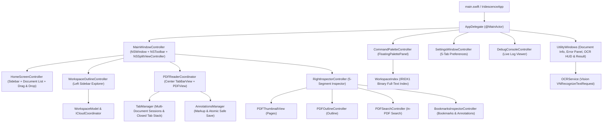

# Iridescence PDF Reader — Native Swift Architecture

## 1. Architectural Overview

The rewritten **Iridescence PDF Reader** is a 100% native Swift 6 macOS application built directly on Apple's **AppKit**, **SwiftUI**, **PDFKit**, **Vision**, and **Foundation** frameworks with **zero Rust code or third-party dependencies**.

---

## 2. Framework Selection Decisions (AppKit vs. SwiftUI)

Our guiding principle is: **choose the framework that produces the highest-quality, fastest, most reliable native macOS experience for each component.**

1. **Window Shell, Split Views & Unified Toolbar (`AppKit`)**:
   - `MainWindow` (`NSWindow` subclass) and `NSSplitViewController` provide deterministic control over full-size content views, traffic-light button clearance, sidebar minimum/maximum thicknesses (`180..360pt`), holding priorities, and keyboard shortcut routing (`performKeyEquivalent`).
2. **PDF Rendering & Thumbnails (`PDFKit` / `AppKit`)**:
   - `PDFView` and `PDFThumbnailView` are used directly without unnecessary wrapper layers, ensuring hardware-accelerated tiled rendering and native trackpad gesture handling.
3. **Outline & Table Views (`AppKit` + `GlassTableRowView`)**:
   - `NSOutlineView` and `NSTableView` with custom `GlassTableRowView` and `HoverCoordinator` guarantee 120 Hz scrolling, single-click responsiveness, zero offscreen black selection artifacts in `cacheDisplayInRect:`, and full support for Increase Contrast / Reduce Transparency accessibility modes.
4. **Command Palette (`AppKit NSPanel`)**:
   - `FloatingPalettePanel` (`NSPanel` subclass with `.borderless`, `.nonactivatingPanel`, floating window level, and `.popover` visual effect material) ensures zero-latency appearance on `Cmd+P`, deterministic cursor placement at the end of prefilled prefixes (`>`, `p:`), and smooth dynamic height resizing (`48pt` to `420pt`).
5. **Declarative Value Models & Concurrency (`Swift 6` + `Foundation`)**:
   - All domain models (`TabSession`, `BookmarkEntry`, `AnnotationSummary`, `IndexedDocument`, `PaletteItem`, `SettingsState`, `LogEntry`) are pure Swift value types (`struct` / `enum`, `Sendable`, `Equatable`), managed by `@MainActor` coordinators and background `Task` workers using `autoreleasepool` for bounded memory usage.

---

## 3. Module Breakdown (`Sources/Iridescence/`)

| Module File | Responsibility |
|---|---|
| `UIConstants.swift` | Design tokens: corner radii, sidebar widths (`180..360pt`), row heights (`28pt`, `34pt`, `38pt`, `44pt`), typography helpers, and semantic color helpers. |
| `Logger.swift` | Thread-safe bounded ring buffer logger (`MAX_LOG_BUFFER_SIZE = 2000`) with categories (`UI`, `WORKSPACE`, `ICLOUD`, `PDF`, `ERROR`) and subscriber notifications. |
| `WindowGeometry.swift` | Screen-clamped window framing (`Home`, `Reader`, `Palette`, `DebugConsole`, `Utility`), NaN/Inf sanitization, and autosave frame restoration. |
| `SettingsManager.swift` | Typed accessors and defaults registration for all 14 `NSUserDefaults` preference keys, plus appearance mode application (`System`, `Light`, `Dark`). |
| `SettingsWindowController.swift` | Native 5-tab Settings window (`General`, `Reading`, `Workspace`, `Appearance`, `Advanced`) with icon-above-label tab pills and `Restore Defaults`. |
| `GlassTableRowView.swift` | Custom `NSTableRowView` suppressing internal `NSVisualEffectView` black capture artifacts and rendering `6.5pt` rounded selection/hover pills with high-contrast support. |
| `HoverCoordinator.swift` | Single-row hover state tracker for `NSTableView` and `NSOutlineView` that clears stale hover states on mouse exit and scroll events. |
| `EmptyStateView.swift` | Reusable centered empty state view with SF Symbol icon, primary title, and secondary guidance subtitle. |
| `BookmarksManager.swift` | Manages `UserBookmarks_v2` in `NSUserDefaults`, `/private` symlink path canonicalization, bookmark migration on Save As, and Markdown export of bookmarks & annotations. |
| `AnnotationsManager.swift` | Multi-line `quadrilateralPoints` markup creation (`Highlight`, `Underline`, `Strikeout`, `TextNote`), annotation extraction/removal, and atomic safe saving with strict `/Documents/MASTER` read-only protection. |
| `BookmarksInspectorController.swift` | Right sidebar controller for segment 3 (`Bookmarks`) and segment 4 (`Annotations`) with filter switching, context menus (`Jump to Page`, `Copy Text`, `Remove`), and empty states. |
| `WorkspaceModel.swift` | `WorkspaceNode` tree representation, async directory enumeration, symlink cycle detection (`Set<String>`), depth cap (`<= 25`), item count cap (`<= 50,000`), and hidden file filtering. |
| `ICloudCoordinator.swift` | Detects iCloud ubiquity states (`local`, `cloudOnly`, `downloading`, `failed`), triggers `startDownloadingUbiquitousItem(at:)`, and coordinates download status updates. |
| `WorkspaceOutlineController.swift` | Left sidebar `NSOutlineView` controller for Workspace mode with folder/PDF icons, iCloud status badges/spinners, single-click PDF opening, and active file auto-reveal. |
| `WorkspaceIndex.swift` | Binary `IRIDX1` workspace full-text index serializer/deserializer with all 4 defensive DoS bounds, background incremental PDF text extraction inside `autoreleasepool`, and UTF-8 safe snippet builder. |
| `TabManager.swift` | Manages open `TabSession`s, active tab index, `ClosedTabInfo` stack (max 25), canonical path deduplication, and physical keycode mapping (`Cmd+1..9` for QWERTY & AZERTY). |
| `TabBarView.swift` | Liquid Glass multi-document tab bar with active/inactive pills, dirty indicator (`●`), close button (`xmark`), `+N ▾` overflow menu, `+` new tab button, and right-click context menu. |
| `PDFOutlineController.swift` | Right sidebar controller for segment 1 (`Outline`) with cycle/depth-safe `PDFOutline` traversal, scroll-synchronized current section highlight, and Expand/Collapse All context menu. |
| `PDFSearchController.swift` | Right sidebar controller for segment 2 (`Search`) with sync/async PDFKit search, match count banner, snippet extraction, yellow selection highlights, and keyboard navigation. |
| `OCRService.swift` | Background Apple Vision `VNRecognizeTextRequest` (`.accurate`) page OCR with 2x rasterization, cancellation token, floating running HUD, and OCR Result Panel. |
| `CommandPaletteController.swift` | `FloatingPalettePanel` and controller supporting `Cmd+P` / `Cmd+Shift+P`, prefixes (`>`, `/`, `//`, `@`, `#`, `p:`/`:`), `scoreQueryMatch` ranking, cursor placement at end without selection highlight, and 26pt hint footer. |
| `HomeScreenController.swift` | Home view controller with left source-list sidebar (`Home`, `Continue Reading`, `Recent`, `Favorites`, `Local Files`, `iCloud Drive`, `Workspaces`), header action buttons, inline filter, 44pt document table with progress badges, and drag-and-drop support. |
| `DebugConsoleController.swift` | Live diagnostic console window with `Clear`, `Pause/Resume`, and `Auto-scroll` controls. |
| `UtilityWindows.swift` | Document Info window (`Cmd+I`) and Error Panel window. |
| `MainWindowController.swift` | `MainWindow` (`NSWindow` subclass handling `Cmd+1..9` physical keycodes and drag-and-drop), unified `NSToolbar`, 3-pane `NSSplitViewController`, responsive sidebar auto-collapse, Presentation & Focus modes, and PDF reader coordination. |
| `AppDelegate.swift` | Application lifecycle, main menu bar construction with all keyboard shortcuts, `NSUserDefaults` persistence for Recents/Workspaces/Favorites/Reading Position, and action handlers. |
| `VisualQAHarness.swift` | Automated visual verification suite capturing all 22+ canonical Light/Dark/Component/Feature screenshots to `/tmp/iridescence-swift-visual-qa/` and legacy QA paths. |

---

## 4. Safety, Bounds & Persistence Invariants

1. **`/Users/theodeville/Documents/MASTER` Read-Only Protection**:
   - Enforced in `AnnotationsManager.isMasterProtectedPath(_:)` and `AnnotationsManager.saveDocumentSafely(_:to:)` before any file write or temp-file rename can occur. Tested explicitly in unit tests and Visual QA.
2. **Zero Data Loss Persistence Compatibility**:
   - Uses identical `NSUserDefaults` keys (`UserBookmarks_v2`, `RecentFiles`, `RecentWorkspaces`, `FavoriteFiles`, `PDFPos_*`, `RightSidebarMode`, and all 14 `Pref*` keys) and the exact `IRIDX1` binary index format at `~/Library/Caches/com.iridecence.pdfreader/workspace_index.bin`.
3. **Defensive Deserialization & Recursion Bounds**:
   - `WorkspaceIndex`: `itemCount <= 50_000`, `pathLength <= 4,096`, `pageCount <= 25,000`, `pageTextLength <= 5,000,000`.
   - `WorkspaceModel`: `maxDepth <= 25`, `maxItems <= 50,000`, canonical path cycle detection.
   - `PDFOutlineController`: `maxDepth <= 10`, `maxNodes <= 5,000`.
   - `AppLogger`: `maxEntries = 2,000`.
